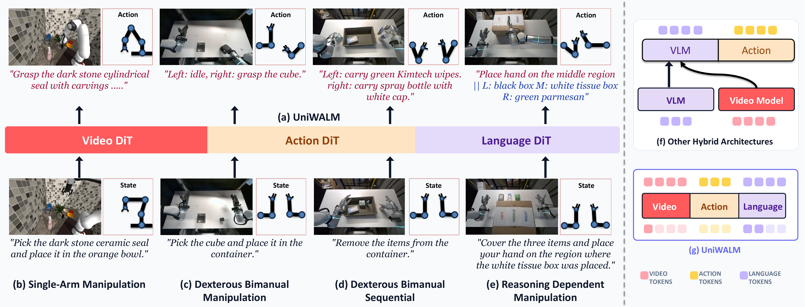
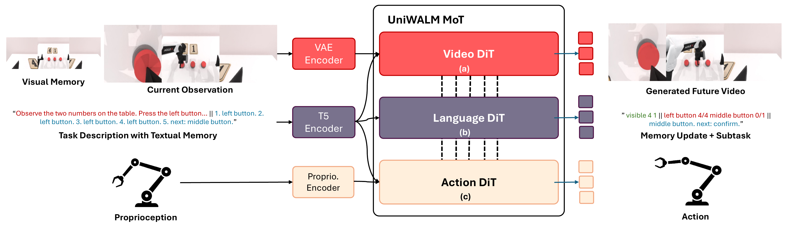
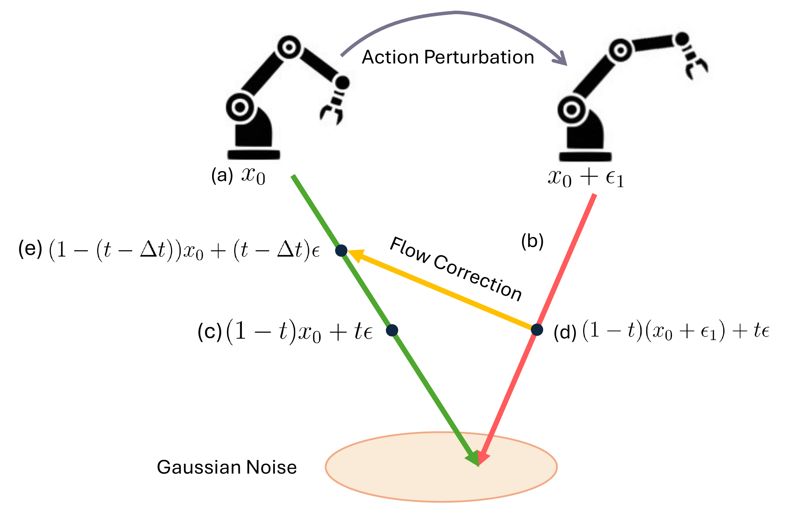
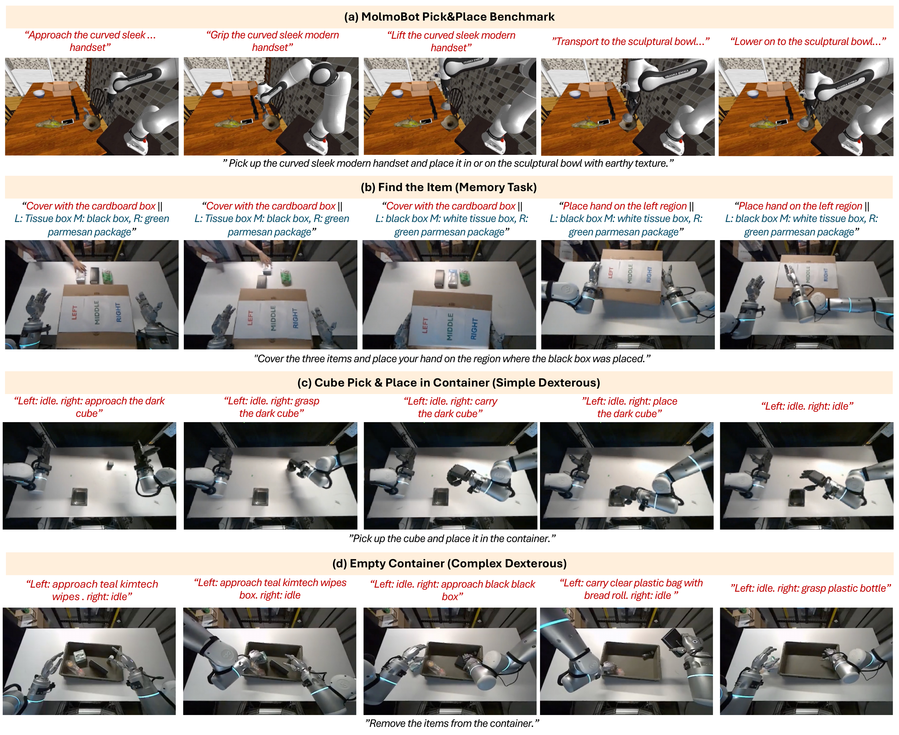
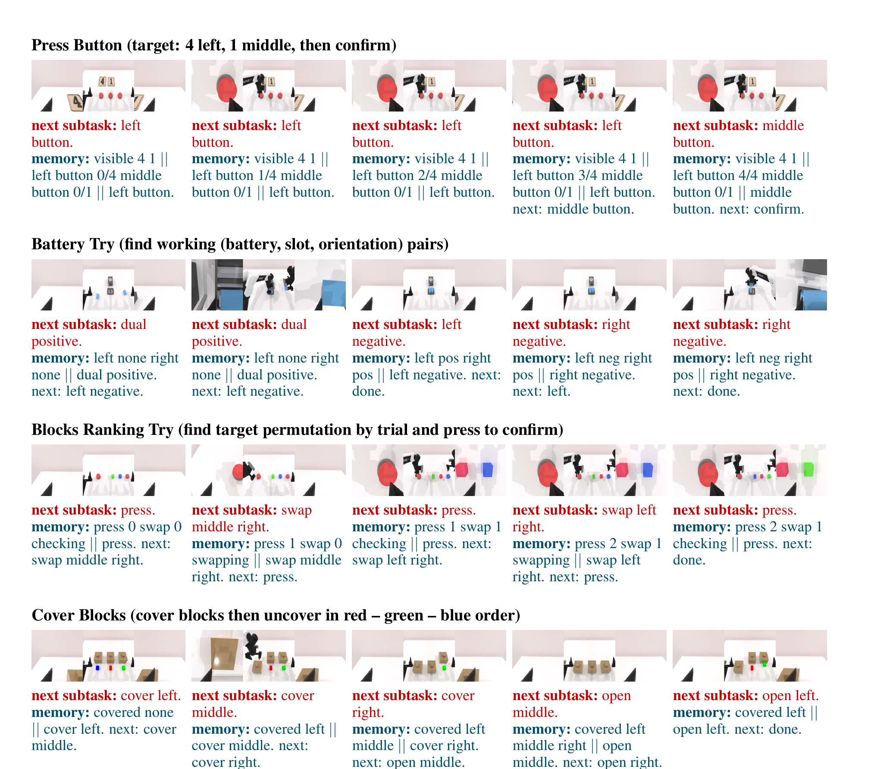

<div align="center">

# UniWALM: Unified World–Action–Language Model for Embodied Robot Control

[](https://arxiv.org/abs/2610.28626)
[](https://rahulsajnani.github.io/projects/uniwalm/)

[**Rahul Sajnani**](https://rahulsajnani.github.io/)<sup>1,2</sup>,
Diego Romeres<sup>2</sup>,
Mingyuan Zhang<sup>2,3</sup>,
Kai Gao<sup>2</sup>,
Carl Qi<sup>2,4</sup>,
Baichuan Huang<sup>2</sup>,
[Srinath Sridhar](https://cs.brown.edu/people/ssrinath/)<sup>1</sup>,
Dylan Randle<sup>2</sup>,
Lillian J. Ratliff<sup>2,5</sup>,
Jose Barreiros<sup>2</sup>,
Manikantan Nambi<sup>2</sup>,
[Jeroen Vanbaar](https://scholar.google.com/citations?user=u8FiVv8AAAAJ&hl=en)<sup>2</sup>

<sup>1</sup> Brown University  ·  <sup>2</sup> Amazon  ·  <sup>3</sup> Northeastern  ·  <sup>4</sup> UT Austin  ·  <sup>5</sup> University of Washington

<br/>



</div>

<p align="center">
  <b>A single mixture-of-transformers backbone co-denoises video, action, and natural-language memory in one parallel diffusion pass — closing a <i>generate → remember → act</i> loop entirely inside the network.</b>
</p>

---

## 📜 Table of Contents

- [TL;DR](#-tldr)
- [Abstract](#-abstract)
- [Method](#-method)
  - [Mixture-of-Transformers backbone](#mixture-of-transformers-backbone)
  - [Language-as-Memory loop](#language-as-memory-loop)
  - [Flow Matching with Correction (FMC)](#flow-matching-with-correction-fmc)
- [Results](#-results)
- [Code & Checkpoints](#-code--checkpoints)
- [Citation](#-citation)
- [Related Project Page](#-related-project-page)
- [Contact](#-contact)

---

## ✨ TL;DR

UniWALM is a unified world–action–language policy for memory-dependent robot manipulation. One network jointly denoises *future video*, *robot action*, and *natural-language memory* at every control step — the language stream carries task state across steps, so the robot *remembers what it just did* without any external planner, VLM, or memory bank.

- **61.1%** on real-world *Find-the-Item* (vs **11.1%** same-backbone FastWAM)
- **34.5%** on RMBench memory benchmark — **beats** Mem-0 with privileged keyframes (28.5%) using only a single anchor frame
- **+21.2 pt** absolute lift on RMBench vs same-backbone FastWAM — *without any pretrained VLM*
- *Reasoning at the speed of action* — action and language can be sampled at inference *without* generating a full future video

---

## 📝 Abstract

Motivated by the human ability to integrate experience across **language**, **perception**, and **action**, we introduce **UniWALM**, a unified world–action–language model that learns video, action, and language in a *single shared representation*, where each modality serves as both a conditioning signal and a supervision target.

Unlike prior approaches that *attach* a separate reasoning or vision-language model to a video–action backbone and run them as distinct stages, UniWALM unifies all three modalities inside a **single mixture-of-transformers backbone** with per-modality diffusion heads that denoise *synchronously*. Subtask and textual-memory tokens are decoded in the same denoising pass as action — no separate planning stage — and action / language generation at inference does not require synthesizing future video.

A short natural-language memory string, generated by the language stream at every control step, is re-consumed by the policy on the next step. This closes a tight **generate → remember → act** loop entirely inside the network, giving memory-dependent behavior as a natural consequence of the unified formulation.

---

## 🧠 Method

### Mixture-of-Transformers backbone

Three expert streams share co-attention and denoise synchronously via per-modality diffusion heads:

1. **Video expert** — Wan2.2 video diffusion over future frames.
2. **Action expert** — a Diffusion Transformer over action chunks.
3. **Language expert** — a **discrete diffusion** head over subtask / memory tokens.

All three streams denoise *in parallel* at every timestep. At inference, action and language can be sampled *without* synthesizing a full future video — hence *reasoning at the speed of action*.

<p align="center">
  
</p>

### Language-as-Memory loop

At every control step, the policy **generates** a short natural-language memory describing its own progress (e.g., which subtask has been completed, which object was just picked up). On the next step the policy **re-reads** its own generated memory as conditioning. The result: memory-dependent behavior emerges as a natural consequence of the unified formulation — no external memory bank or privileged keyframes required.

### Flow Matching with Correction (FMC)

To improve **action reliability**, we introduce *Flow Matching with Correction* — a training objective that teaches the policy to recover from **perturbed action trajectories**. Perturbation is applied only during training, so there is **zero additional inference cost**. On a 2D end-effector-trajectory toy benchmark, FMC reduces unconditional Chamfer distance by **4.0%** and wins on **5/7** shape classes (**71.4%** win rate) over the linear flow-matching baseline.

<p align="center">
  
</p>

---

## 📊 Results

### Real-world Find-the-Item (memory-dependent)

| Model | Backbone | Pretrained VLM | Success |
|---|---|---|---|
| State-of-the-art VLAs | — | ✓ | ≤ 33.3% |
| FastWAM (same-backbone) | Wan2.2 | ✗ | 11.1% |
| **UniWALM (ours)** | **Wan2.2** | **✗** | **61.1%** |

### RMBench — M(N) memory subset

| Model | Keyframes | Pretrained VLM | Success |
|---|---|---|---|
| FastWAM (same-backbone) | — | ✗ | 13.3% |
| Mem-0 | Privileged per-task | ✓ | 28.5% |
| **UniWALM (ours)** | **Single anchor only** | **✗** | **34.5%** |

- **+21.2 pt** absolute improvement over same-backbone FastWAM
- Beats Mem-0 **without** per-task privileged keyframes **and without** any pretrained VLM

### MolmoSpaces (simulation)

UniWALM achieves the highest success rate on all three compositional pick-and-place variants, improving over the closest world-action model (FastWAM) sharing the same Wan2.2 backbone by **+14.8%** on average.

### Qualitative rollouts

<p align="center">
  
</p>

<p align="center">
  
</p>

Rollouts across the four task families — *MolmoBot Pick&Place*, *Find-the-Item (memory)*, *Simple dexterous*, *Complex dexterous*. Red captions are the generated *subtask / memory* tokens the policy produces at each step and re-reads on the next.

> Full rollout videos and additional ablations are on the [project page](https://rahulsajnani.github.io/projects/uniwalm/).

---

## 💻 Code & Checkpoints

> **Code and pretrained checkpoints will be released after the review process concludes.**

To get notified when the release lands:

- ⭐ **Star this repo** (top-right of this page)
- 👤 Follow [@RahulSajnani](https://github.com/RahulSajnani) on GitHub

Planned release:
- Training code (PyTorch, FSDP, HuggingFace Accelerate; multi-node 10× H100/B200)
- Pretrained checkpoints
- Evaluation harness for RMBench M(N) and MolmoSpaces
- Data preprocessing pipeline for Find-the-Item
- Flow Matching with Correction reference implementation

---

## 📚 Citation

If you find UniWALM useful in your research, please cite:

```bibtex
@misc{sajnani2026uniwalmunifiedworldaction,
      title={UniWALM: Unified World Action Language Model for Embodied Robot Control},
      author={Rahul Sajnani and Diego Romeres and Mingyuan Zhang and Kai Gao and Carl Qi and Baichuan Huang and Srinath Sridhar and Dylan Randle and Lillian J. Ratliff and Jose Barreiros and Manikantan Nambi and Jeroen Vanbaar},
      year={2026},
      eprint={2610.28626},
      archivePrefix={arXiv},
      primaryClass={cs.RO},
      url={https://arxiv.org/abs/2610.28626}
}
```

---

## 🔗 Related Project Page

For the full visual walkthrough — architecture figure, Memory-Loop illustration, Flow-Matching diagram, RMBench rollout videos, and all qualitative comparisons — visit the **[project page](https://rahulsajnani.github.io/projects/uniwalm/)**.

---

## 📬 Contact

Primary contact: Rahul Sajnani — `rahul_sajnani [at] brown [dot] edu`
For broader questions about the Amazon side of the project: `jvbaar [at] amazon [dot] com`
